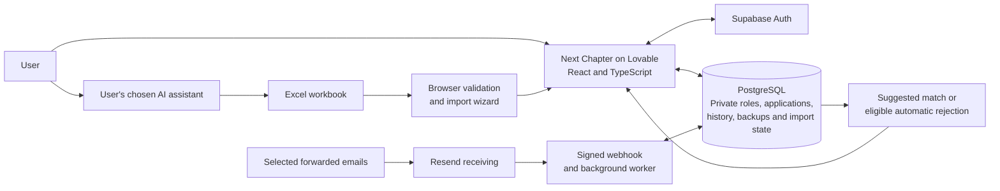

# Next Chapter

### Track your applications. Keep your next step clear.

Next Chapter is a private **job application tracker** that keeps researched roles, resume-fit and priority scores, application decisions, notes and follow-ups together. Bring in a research workbook, keep it current without overwriting personal tracking, and follow the status changes you actually record.

**[Open Next Chapter](https://next-chapter-by-khiz.lovable.app/)** · **[Try the demo](https://next-chapter-by-khiz.lovable.app/?view=demo)** · **[Architecture](architecture.md)**

Built by [Khizer](https://built-by-khiz.lovable.app/) · [GitHub](https://github.com/Built-by-Khiz)

This repository contains public product and architecture documentation. Application source code, deployment secrets and private workspace data are maintained separately.

## Why I built it

Researching opportunities and tracking applications create different kinds of information. A posting has company and role facts. A candidate has preferences, personal notes, decisions and follow-up dates. Those details often end up scattered across spreadsheets, browser tabs, email and research conversations.

Next Chapter connects them while keeping their responsibilities separate. Research refreshes can update job information without resetting an application's status, notes or dates. Forwarded rejection emails can become a reviewed status update. Backups provide a way to return to an earlier workspace.

## What you can do

| Capability                   | How it helps                                                                                                                                                                             |
| ---------------------------- | ---------------------------------------------------------------------------------------------------------------------------------------------------------------------------------------- |
| Track applications           | Keep company, role, posting link, location, status, notes and dates together.                                                                                                            |
| Update status quickly        | Click a card's status label, or select several cards for a bulk status change. Company-interest decisions ask whether to affect the selected roles or all current roles at that company. |
| Compare scores               | Display and sort imported **Resume fit /100** and **Priority /100** scores independently.                                                                                                |
| Search naturally             | Combine company, role, notes, dates and supported score comparisons such as `resume fit above 80`. The app uses a defined local grammar.                                                 |
| Import with guidance         | Step through **File → Review → Updates → Cleanup → Import**, with aggregate counts, optional row details and progress beside the action.                                                 |
| Refresh and clean up         | Add missing records, skip existing records or refresh their research. Review explicit workbook deletion requests and optional cleanup of selected personal-status categories.            |
| Reuse current context        | Export all current applications as JSON for a future research workbook, retaining identity and personal decisions.                                                                       |
| Use your own AI assistant    | Copy a reusable prompt or download a skill and template. The assistant runs outside Next Chapter using the context and preferences you choose to share.                                  |
| Process forwarded emails     | Receive selected application emails at a private forwarding address, review suggested matches, or opt into automatic rejection updates under strict conditions.                          |
| See real progress            | Follow recorded status changes in a home-screen Sankey. Applications with no actual change go directly to their current status.                                                          |
| Recover or clear a workspace | Create manual or scheduled backups, download/upload backup JSON, preview a restore, or use protected deletion with a required safety copy.                                               |
| Work through a long list     | Browse compact cards, expand notes and reveal another 50 matching roles as you scroll. A superscript **NEW** identifies applications added within seven days.                            |

Google sign-in, email/password accounts, password reset, light/dark themes and a fictional browser-only demo are also supported.

## A quieter workspace

The latest interface keeps **Add application** and **Import workbook** visible. **Email updates**, **Export applications** and **Backups** sit in the `…` menu.

Info icons beside headings expand instructions below the heading when clicked. They do not rely on hovering. Relevant setup instructions, errors and confirmation requirements remain visible while the user performs the action. Card edits retain the active search, filters, sort and list position where possible; a thin progress bar and brief confirmation highlight keep feedback close to the changed card.

On the import page, file selection is the default. A headline button opens **Build a workbook with your own AI assistant** as a separate view; **File Import** returns to the wizard. The aggregate preview remains visible while the paginated record list starts collapsed.

## One example journey

1. Give your preferred AI assistant the in-app prompt, the resume context you choose, and your confirmed preferences.
2. Import its workbook through the wizard. Review any proposed deletions separately before they can run.
3. Sort by priority, narrow the list with a query such as `resume fit above 80`, and record applications through the status labels.
4. Forward selected application emails. Review a suggested company-and-role match before confirming a rejection, or enable the narrowly scoped automatic mode after setup.
5. Export current application context when preparing the next research refresh. Preserve stable Source IDs so reimports can recognize existing records.
6. Follow actual status changes on the chart and use a backup if you need to restore an earlier state.

## Architecture at a glance

| Layer                          | Technology or approach                                                                                                 |
| ------------------------------ | ---------------------------------------------------------------------------------------------------------------------- |
| Interface                      | React, TypeScript, Tailwind CSS, Radix UI and Lucide icons                                                             |
| Framework                      | TanStack Start, TanStack Router, TanStack Query and Vite                                                               |
| Hosting                        | Lovable                                                                                                                |
| Authentication and persistence | Supabase Auth and PostgreSQL                                                                                           |
| Data operations                | Account-scoped reads, row-level security and owner-checked database functions                                          |
| Workbook processing            | SheetJS in a browser Web Worker; resumable staged imports                                                              |
| Search and progress            | Local query parsing, custom SVG Sankey and exact-count tables                                                          |
| Email updates                  | Resend receiving, authenticated server routes, deterministic classification and matching, queued background processing |
| Scheduled work                 | PostgreSQL scheduling for backups and email-worker requests                                                            |

## Product decisions

- **Availability, personal status and scores answer different questions.** An open posting does not mean an application was submitted. Scores are research assessments, not hiring probabilities.
- **Personal work survives a research refresh.** Existing application statuses, notes and dates are preserved. Imported research fields are replaced by the accepted snapshot, so known information should be carried forward deliberately.
- **Cleanup is explicit.** A missing row is not a deletion request. Workbook annotations and user-selected status categories produce a deletion plan that needs separate confirmation.
- **Email updates require evidence.** Manual forwards and uncertain matches need review. Automatic mode is limited to eligible Applied or Interviewing records with a trusted, authenticated sender, clear rejection and one strict match.
- **History represents recorded changes.** Same-status writes do not create extra Sankey stages, and incomplete history is not filled with guessed transitions.
- **Unknown facts remain unknown.** The external scoring prompt distinguishes observed inputs from explicitly labeled estimates and reports evidence coverage.
- **Long operations are recoverable.** Imports use saved run state and acknowledged batches. Bounded work, retries and outcome checks reduce timeout problems without promising that failures can never occur.

## Project status

Next Chapter is published and in active personal use. This documentation reflects the latest implemented application version, including the UI refresh prepared on November 1, 2026. That refresh passed local production-build and desktop/mobile checks; its publication has not yet been confirmed.

Forwarded-email receipt and manual rejection review have been exercised in use. The latest local checks also cover email processing, precise match suggestions, import interactions and status-history behavior. These checks do not claim universal email classification accuracy or a completed live automatic-update test.

Python dataset validation, MLflow evaluation and optional Databricks experiments remain proposed follow-on work. They are not dependencies of the running application.

## Documentation

| Document                                                  | What it covers                                                                   |
| --------------------------------------------------------- | -------------------------------------------------------------------------------- |
| [Product brief](PRD.md)                                   | Problem, users, journeys, interaction decisions and scope                        |
| [Architecture](architecture.md)                           | Components, data model, import reliability, email processing and boundaries      |
| [Research and import workflow](import-and-ai-workflow.md) | External AI, current score model, workbook contract, refresh and cleanup         |
| [Forwarded email updates](email-updates.md)               | Forwarding setup, suggestions, review, automatic-update conditions and retention |
| [Roadmap](roadmap.md)                                     | Implemented capabilities, validation priorities and proposed evaluation tools    |
