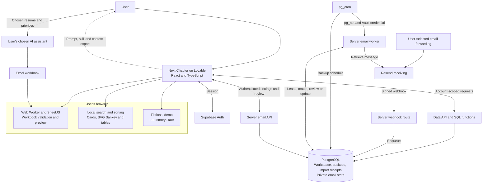

# Next Chapter architecture

Next Chapter is a private job application tracker. Its React and TypeScript interface runs through Lovable, with Supabase Auth and PostgreSQL for accounts and workspace data. Workbook validation, search, sorting and chart rendering run in the browser. Transactional writes and recovery checks run in the database. Forwarded email is handled by a separate server-side queue and worker.

This document describes the latest maintained implementation, including the prepared UI refinement. It is a high-level overview, not a deployment bundle. See the [README](README.md) for release status.

## System overview

The external research assistant is selected by the user. Next Chapter does not call an LLM to search, generate scores, process a resume or classify email. Email matching uses deterministic rules and explicit review controls.

## Component responsibilities

| Component           | Responsibility                                                                                                                      |
| ------------------- | ----------------------------------------------------------------------------------------------------------------------------------- |
| Application shell   | Landing page, demo, account views, theme and navigation.                                                                            |
| Authentication      | Email/password and Google sign-in, session handling and password recovery.                                                          |
| Workspace client    | Verify account identity, load records, submit changes and clear account-specific state when the user changes.                       |
| Workbook worker     | Inspect the XLSX container, recognize supported formats, validate values and return normalized preview rows.                        |
| Import controller   | Guide the user through five steps, stage rows, obtain review confirmation, track durable progress and recover interrupted requests. |
| Search and list     | Apply supported local query rules and sorting, then reveal matching cards in groups of 50.                                          |
| Progress model      | Build paths from actual status changes and produce exact-count tables without inventing earlier stages.                             |
| Help and feedback   | Expand guidance from an info button, retain essential action warnings, and show progress and success close to the affected control. |
| SQL functions       | Coordinate saves, bulk statuses, imports, cleanup, backups, restores and account boundaries.                                        |
| Email server routes | Verify webhook signatures, authenticate user actions, process queued messages and keep provider credentials server-side.            |
| Demo adapter        | Keep fictional interactive records in browser memory, separate from private accounts.                                               |

The interface uses React, TypeScript, Tailwind CSS, Radix UI and Lucide icons. TanStack Start, Router and Query provide the application framework and data coordination; Vite builds the application.

## Data model

| Data                          | Purpose                                                                                                                 |
| ----------------------------- | ----------------------------------------------------------------------------------------------------------------------- |
| `job_roles`                   | Company and role facts, posting availability, stable source identity and imported research, including scores.           |
| `applications`                | The user's status, notes, applied date and follow-up date for a role.                                                   |
| `application_status_events`   | Initial or baseline observations and recorded status changes.                                                           |
| `application_backups`         | Account-owned snapshots of roles, applications and status history.                                                      |
| `application_backup_settings` | Before-change protection, schedules and retention preferences.                                                          |
| Private import tables         | Run identity, staged rows, confirmed offsets, counters and the reviewed deletion plan.                                  |
| Private workspace revisions   | Detect changes that invalidate an import review or interrupt a running import.                                          |
| Private email tables          | Forwarding connections, queued messages, review evidence, processing receipts, worker health and application revisions. |

A user-owned role has at most one associated application. Row-level security and owner checks in database functions enforce account boundaries. Private import and email tables are not directly exposed to ordinary clients. Deleting a role removes its application and recorded status history; saved backups remain separate.

## Core data flows

### Authenticate and load

The client establishes a Supabase session, verifies the signed-in user and reads that account's workspace. Private requests retain the expected owner identity. Account changes clear cached data and interrupt operations associated with the prior account.

Password recovery uses a Supabase recovery session and a dedicated new-password form. The client verifies that session before changing the password. Recovery redirects and provider password policies remain part of the backend configuration.

### Edit and change status

An ordinary save writes role details and personal tracking fields together under a per-account transaction lock. Unchanged values avoid unnecessary writes, timestamps, history and repeat safety copies. Editing only notes, dates or status does not rewrite the research row.

The card's status label opens a quick status action. Multi-selection supports bounded bulk updates. Choosing **Not interested in the company** asks whether to affect the selected role or all current roles matching that company. The interface preserves filters and scroll context, shows an in-card progress line and uses temporary local confirmation styling.

Ordinary form edits retain last-write-wins semantics. Bulk work commits in groups, so partial progress can remain after a later failure. Email approvals and automatic updates add version checks to avoid applying a stale decision.

### Validate, review and import

1. **File:** the user selects an Excel workbook. Parsing and initial validation stay in a browser worker.
2. **Review:** aggregate results are visible; the paginated record preview expands on demand.
3. **Updates:** the user chooses to skip existing records or refresh eligible research.
4. **Cleanup:** the user can keep existing declined/unavailable roles or include selected status categories in a deletion review.
5. **Import:** the user confirms the destination and starts staging. The server produces the deletion plan, requests a separate confirmation when needed, saves a safety copy and processes small groups.

Run IDs, normalized-content fingerprints, confirmed offsets and server-side receipts support resuming without replaying acknowledged work. Staging and processing start with 25 rows and adapt within bounded limits. Slow or timed-out batches become smaller; uncertain responses trigger a server checkpoint read before the next request. Repeated failures pause the run with confirmed progress intact.

The server binds deletion confirmation to the reviewed workspace revision. A changed plan requires a fresh review. The safety copy must succeed before any import changes, and another workspace write can interrupt the run rather than silently applying an outdated plan.

Each processing request is transactional. The whole workbook is not one transaction: cancellation or a later failure does not undo earlier committed groups. Resume uses the existing run and safety copy. A new run is a separate import.

Stable source IDs match existing imported roles. Research refresh accepts eligible same-date or newer snapshots and preserves existing personal status, notes and application dates. Older research for a retained role blocks refresh confirmation; the user must review the workbook or choose Skip existing records. Missing rows alone are not deletion instructions. See the [import workflow](import-and-ai-workflow.md) for explicit deletion and optional status cleanup.

### Read, search and chart

Workspace reads use bounded pages that shrink after qualifying failures. The current client supports up to 5,000 applications. Filtering and sorting apply to the complete fetched workspace before cards are progressively revealed. Infinite scrolling is progressive rendering, not a server-side cursor search.

Search supports a defined grammar for text, fields, dates and score comparisons. Scores come from imported research; a missing score remains unknown. A superscript **NEW** marks applications created within the previous seven days, independently of research or edit dates.

The chart reads a lean application/history snapshot. Unchanged applications connect directly to **Current status**, even when other records have histories. Only genuine status changes add historical steps; repeated writes of the same status do not create steps. The final status appears once. Ambiguous history remains explicitly incomplete, and long paths can fall back to a current-status view.

### Export, back up and clear a workspace

**Export applications** downloads all current applications, regardless of list filters, as JSON context for a future research prompt. It includes personal notes, dates, source identities and research, but excludes status history. It is neither an import workbook nor a restorable backup. Records without a compatible workbook source identity are marked reference-only.

Manual and automatic backups include roles, applications and status history. A downloaded backup JSON can be uploaded as a saved copy for the same account. Upload alone does not replace the workspace. Validation happens before taking the workspace lock where possible, and a stable request identity supports repeat submissions.

Restore preview compares record counts and checks workspace state. Confirmed restore saves a safety copy and replaces workspace records transactionally. The advanced **Delete all applications** action similarly requires a reviewed workspace, typed confirmation and a successful safety copy. Account details, saved backups and automatic backup preferences remain.

Scheduled backups use `pg_cron` independently of an open browser. Their settings distinguish schedule registration from recent execution.

### Process forwarded email

A signed Resend webhook identifies the private receiving address and queues the provider's message ID. A scheduled worker claims a small number of messages, retrieves content from Resend, identifies possible rejections and matches candidate applications. It stores bounded text excerpts and review evidence rather than displaying active email HTML.

The default is human review. Automatic rejection additionally requires verified forwarding, an exact trusted sender, provider-verified authentication, a fresh explicit rejection, one qualifying match and unchanged role/application state. Manual forwards remain review-only. Leases, duplicate receipts and retry backoff support recovery. See [Email updates](email-updates.md) for the complete user-facing flow and limits.

## Reliability and boundaries

- Per-account locking coordinates writes, imports, backups, restores and deletion. Bounded lock waits avoid waiting indefinitely on a busy workspace.
- SQL statement budgets, smaller batches, no-op saves and durable checkpoints work together. Increasing a timeout alone is not the recovery strategy, and no system can guarantee that requests never time out.
- Known database rollbacks and unknown network outcomes are distinguished. The interface does not report an uncertain write as confirmed success.
- Confirmed import sends normalized records to the backend; selecting a workbook for preview does not upload the original file.
- The forwarding integration processes messages addressed to a user's private address. It does not connect to or read the entire mailbox.
- Provider and worker credentials stay on the server. User review requests require an authenticated account; worker operations use a separate privileged path.
- Demo data does not write to the private database. Export and backup files can contain private tracking information.
- This public repository contains documentation only. It contains no application credentials, deployment bundle, private workspace data or production source code.

## Current limits and tradeoffs

| Area                | Current behavior                                                                                                                                                    |
| ------------------- | ------------------------------------------------------------------------------------------------------------------------------------------------------------------- |
| Workbook input      | Supported template and legacy Superset formats; 10 MiB on disk, 64 MiB expanded, 5,000 rows and 32 MiB of staged normalized data.                                   |
| Resulting workspace | Must remain within supported role and safety-snapshot capacity after planned cleanup and import.                                                                    |
| Formula handling    | Standard template formulas are rejected; supported legacy research can preserve cached results without recalculation.                                               |
| Imports             | One unfinished run per account; processing is driven by the client and can resume from saved progress.                                                              |
| Backups             | Up to 50 snapshots per account and 32 MiB per saved snapshot; protected operations need safety-copy capacity.                                                       |
| Backup upload       | JSON files up to 64 MiB, subject to validation and saved-snapshot limits.                                                                                           |
| Email intake        | Up to 100 accepted messages per connection in a rolling day; bounded processing per worker run.                                                                     |
| Email evidence      | Scheduled cleanup removes stored evidence after 30 days and deduplication receipts after 90 days; users can remove evidence sooner. Provider retention is separate. |
| Model integration   | No runtime dependency on Python, MLflow, Databricks or an LLM provider.                                                                                             |

See the [roadmap](roadmap.md) for proposed validation and evaluation work.
