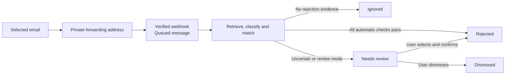

# Email updates

Next Chapter can turn forwarded rejection emails into application-status updates. Users decide which messages reach the app and whether to review each decision or allow a narrowly defined automatic update.

The integration receives forwarded messages through Resend. It does not request access to the user's mailbox, scan old mail or use an LLM to classify messages.

## User flow

1. Open **Email updates** from the workspace's **...** menu in the refined interface.
2. Create a private forwarding address for the account.
3. Add that address to the email provider. The in-app guide supports Gmail forwarding confirmation and a test message.
4. Keep global forwarding disabled and configure a filter for selected recruiting messages.
5. Inspect the received test in **Email activity**, then confirm forwarding in the app.
6. Leave **Review before updating** selected, or supply exact trusted sender addresses and explicitly enable automatic updates.

The user can pause processing or replace the private address. Replacing it resets verification and invalidates pending work for the old address. A Gmail filter forwards new matching mail; an existing message can be forwarded manually for review.

In the refined UI, instructions expand from info icons. The forwarding guide opens during initial setup and collapses after verification. Required decisions and errors remain visible.

## What happens to a message

Processing is scheduled rather than immediate. **Waiting to process** means the message is queued. Temporary failures retry with backoff; exhausted retries appear as failed and can be retried by the user.

A simple connection test without rejection language is normally **Ignored**. That indicates the message was processed without changing an application.

## Suggested applications

Review suggestions compare the email's text with the user's tracked records. A matching posting URL or company plus source ID provides strong identity evidence. Company plus the full role title also ranks strongly; similar wording can provide weaker candidates when no exact match is available.

Specific titles take precedence over a generic title found only inside them. For example, an email naming **Staff Product Manager, Infrastructure** should not present a generic **Staff Product Manager** as an equally specific match merely because those words are contained in the full title. Company-only suggestions are suppressed when exact evidence exists. Independently mentioned roles, duplicates and conflicting links remain visible rather than being silently resolved.

Suggestions help a person choose a record. They do not authorize a status change. The user can search for another role, select it, check the email and explicitly confirm **Rejected**. The confirmation shows the role and the proposed status transition.

## When automatic rejection is allowed

Automatic mode requires all of these checks:

- The forwarding connection is verified, active and explicitly set to automatic mode.
- The sender's complete email address matches the user's trusted-sender list.
- Provider-supplied authentication reports both DKIM and DMARC passing. An email's own `Authentication-Results` header is not accepted as proof.
- The message contains an explicit rejection, without detected conditional wording, a correction or truncated content that requires review.
- The message is not a manual forward. Its original date is within seven days and is not older than the automatic-mode setting or the matched role/application's latest changes.
- Exactly one application qualifies under the worker's strict identity check, and candidate retrieval was not truncated.
- That application is currently **Applied** or **Interviewing** and its stored versions still match the evidence used for the decision.

The server rechecks ownership, state and versions before writing **Rejected**. Missing authentication metadata, an old message, several matches or a manually forwarded email results in review rather than automatic approval.

The worker's strict matching check is separate from the more helpful ranking used in the review screen. A clear top suggestion does not necessarily meet every automatic-update condition.

## Review, dismissal and undo

**Needs review** retains the sender, an excerpt, suggested roles and an explanation. Selecting a role alone does not update it. The user must confirm the rejection after reviewing the email.

**Dismiss** leaves applications unchanged. **Undo** can reverse an email-applied status while the application still matches that update's recorded version. If someone has edited the application since then, the user must review its current state instead of overwriting the newer work.

Status updates use the existing application history and before-change protection. Duplicate delivery and repeated approval requests are checked so that an already-applied result is not blindly applied again.

## Data handling and current scope

- The app stores limited review evidence, including sender, subject and a text excerpt of up to 2,000 characters. It does not render active email HTML or fetch remote images.
- Scheduled cleanup removes stored evidence after 30 days and processing receipts after 90 days. Users can remove evidence earlier; recorded application status history remains. Resend manages its own message retention separately.
- Intake is bounded to 100 accepted messages per connection in a rolling day. The worker claims small batches and uses leases so interrupted processing can be recovered.
- The feature handles rejection updates. It does not automatically infer interviews, offers, acceptance or every possible recruiting outcome.
- Filter wording and deterministic classification can miss unfamiliar phrasing. The activity list and review path expose uncertain outcomes; they do not guarantee perfect interpretation.
- Next Chapter does not send applications or reply to recruiters on the user's behalf.

See [Architecture](architecture.md) for the webhook, worker, database and account boundaries, and the [product brief](PRD.md) for the wider tracking workflow.
